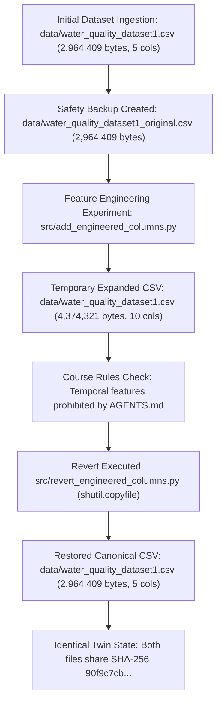

# Dataset Duplicate & Consistency Audit Report — CloudGuard-Water

**Project Name**: CloudGuard-Water: Intelligent and Explainable Water Quality Classification  
**Target Directory**: `data/`  
**Interactive Audit Notebook**: [`notebooks/04a_dataset_consistency_audit.ipynb`](file:///d:/E0224033/ML_for_Cl_Ser/CL/LB_Proj/notebooks/04a_dataset_consistency_audit.ipynb)  
**Date**: October 2026  
**Auditor**: Lead Production Engineer & ML Quality Guardian  

---

## Executive Summary

An investigation was conducted into the presence of two dataset files within the project's `data/` directory:
1. `data/water_quality_dataset1.csv`
2. `data/water_quality_dataset1_original.csv`

The purpose of this audit is to determine whether these two files represent conflicting data sources, whether either file explains historical reporting discrepancies across Phases 1–4, whether any project script accidentally combined both datasets, and to formally establish a single authoritative dataset.

### Key Audit Conclusions:
1. **The Files are Bit-for-Bit Identical Twins**:
   - Both files have the exact same size: **2,964,409 bytes** (2.8271 MB).
   - Both files share the identical SHA-256 hash: `90f9c7cb7404fb69b655ee27293c91b82ee3a346712e06035f8259393835a04a`.
   - Byte-level comparison (`filecmp.cmp`) and DataFrame comparison (`df1.equals(df2)`) return **`True`**.
2. **Why Both Files Exist (Provenance)**:
   - `data/water_quality_dataset1_original.csv` was created as an immutable safety backup before executing `src/add_engineered_columns.py`, which temporarily added 5 temporal features and expanded `data/water_quality_dataset1.csv` to 4,374,321 bytes (4.17 MB).
   - Once temporal features were rejected (conforming to `AGENTS.md` dataset rules), `src/revert_engineered_columns.py` used `shutil.copyfile` to restore `data/water_quality_dataset1.csv` directly from `data/water_quality_dataset1_original.csv`.
3. **No Multi-File Concat or Contamination**:
   - Zero scripts or notebooks concatenate, merge, or append both files.
   - Code referencing both filenames does so exclusively as **fallback candidate paths** for robust path resolution across execution environments (local IDE, terminal, Google Colab).
4. **Historical Discrepancies Explained**:
   - The 4.17 MB figure in past report text was a stale reference to the temporary 10-column file prior to reversion.
   - The block ordering text in earlier drafts was an unintentional typographical transposition of row counts (`Unsafe` count = 70,560) rather than a dataset discrepancy.
5. **Canonical Designation & Phase Rerun Assessment**:
   - **`data/water_quality_dataset1.csv`** is formally designated as the single canonical dataset.
   - `data/water_quality_dataset1_original.csv` is preserved untouched as a verified frozen backup twin.
   - **No phases need to be rerun**, as all models in `models/` were trained on this exact canonical data.

---

## 1. Physical File Identification & Cryptographic Verification

Both files residing in `data/` were audited independently:

| Property | File 1 (`water_quality_dataset1.csv`) | File 2 (`water_quality_dataset1_original.csv`) | Match Status |
| :--- | :--- | :--- | :---: |
| **Filename** | `water_quality_dataset1.csv` | `water_quality_dataset1_original.csv` | Different |
| **Relative Path** | `data/water_quality_dataset1.csv` | `data/water_quality_dataset1_original.csv` | Different |
| **Absolute Path** | `D:\E0224033\ML_for_Cl_Ser\CL\LB_Proj\data\water_quality_dataset1.csv` | `D:\E0224033\ML_for_Cl_Ser\CL\LB_Proj\data\water_quality_dataset1_original.csv` | Different |
| **File Size (Bytes)** | **2,964,409 bytes** | **2,964,409 bytes** | **EXACT MATCH** |
| **File Size (MB)** | 2.8271 MB | 2.8271 MB | **EXACT MATCH** |
| **SHA-256 Checksum** | `90f9c7cb7404fb69b655ee27293c91b82ee3a346712e06035f8259393835a04a` | `90f9c7cb7404fb69b655ee27293c91b82ee3a346712e06035f8259393835a04a` | **EXACT MATCH** |
| **Byte-for-Byte Equality** | `True` (`filecmp.cmp(shallow=False)`) | `True` (`filecmp.cmp(shallow=False)`) | **IDENTICAL** |

---

## 2. Independent Dataset Content Comparison

Both CSV files were loaded into independent Pandas DataFrames and tested for structural and mathematical equivalence.

### 2.1 Dimensionality & Schema

| Metric | `water_quality_dataset1.csv` | `water_quality_dataset1_original.csv` | Discrepancy |
| :--- | :---: | :---: | :---: |
| **Row Count** | 100,800 | 100,800 | None (0) |
| **Column Count** | 5 | 5 | None (0) |
| **Column Names** | `['pH', 'TDS_ppm', 'Turbidity_NTU', 'Temperature_C', 'Label']` | `['pH', 'TDS_ppm', 'Turbidity_NTU', 'Temperature_C', 'Label']` | None |
| **Missing Values (Nulls)** | **0** across all columns | **0** across all columns | None (0) |
| **Duplicate Rows** | **0** duplicate rows | **0** duplicate rows | None (0) |

### 2.2 Class Balance & Label Distribution

| Class Label | `water_quality_dataset1.csv` Count | `water_quality_dataset1.csv` % | `water_quality_dataset1_original.csv` Count | `water_quality_dataset1_original.csv` % |
| :--- | :---: | :---: | :---: | :---: |
| **`Unsafe`** | 70,560 | 70.000% | 70,560 | 70.000% |
| **`Safe`** | 30,240 | 30.000% | 30,240 | 30.000% |
| **Total** | 100,800 | 100.000% | 100,800 | 100.000% |
| **Imbalance Ratio** | **2.333 : 1** (Unsafe to Safe) | | **2.333 : 1** (Unsafe to Safe) | |

### 2.3 Numerical Descriptive Statistics Comparison

| Feature | File | Count | Mean | Std Dev | Min | 25% | Median (50%) | 75% | Max |
| :--- | :--- | :---: | :---: | :---: | :---: | :---: | :---: | :---: | :---: |
| **`pH`** | Standard | 100,800 | 7.5939 | 0.7995 | 6.0900 | 7.0100 | 7.3800 | 8.1000 | 9.9600 |
| | Original | 100,800 | 7.5939 | 0.7995 | 6.0900 | 7.0100 | 7.3800 | 8.1000 | 9.9600 |
| **`TDS_ppm`** | Standard | 100,800 | 692.6470 | 647.3319 | 28.6000 | 163.0000 | 472.8500 | 1023.3250 | 2806.1000 |
| | Original | 100,800 | 692.6470 | 647.3319 | 28.6000 | 163.0000 | 472.8500 | 1023.3250 | 2806.1000 |
| **`Turbidity_NTU`** | Standard | 100,800 | 11.3068 | 9.8684 | 0.0000 | 1.9200 | 9.9700 | 18.5400 | 72.7500 |
| | Original | 100,800 | 11.3068 | 9.8684 | 0.0000 | 1.9200 | 9.9700 | 18.5400 | 72.7500 |
| **`Temperature_C`** | Standard | 100,800 | 24.8835 | 2.6881 | 16.5600 | 23.0900 | 25.0400 | 26.9300 | 31.5100 |
| | Original | 100,800 | 24.8835 | 2.6881 | 16.5600 | 23.0900 | 25.0400 | 26.9300 | 31.5100 |

*Maximum absolute numerical difference across all descriptive statistics*: **`0.000000`**.  
*Strict DataFrame equality (`df1.equals(df2)`)*: **`True`**.

### 2.4 Class Block Layout & Transition Point

An analysis of contiguous label blocks in both files yields identical results:
- **First observation (row 0)**: `Label` = `'Safe'`
- **Last observation (row 100,799)**: `Label` = `'Unsafe'`
- **Contiguous `Safe` block**: Rows **0 to 30,239** (30,240 rows total)
- **Contiguous `Unsafe` block**: Rows **30,240 to 100,799** (70,560 rows total)
- **Transition Point**: Exactly at **Index 30240** (`iloc[30239]` is `Safe`, `iloc[30240]` is `Unsafe`).

---

## 3. Project References & Codebase Audit

We audited all Python scripts, Jupyter notebooks, Markdown reports, and configuration files to trace how datasets are referenced and loaded.

### 3.1 Script & Notebook Loading Patterns

| Category / File | References Standard | References Original | How It Resolves & Loads Data |
| :--- | :---: | :---: | :--- |
| [`src/phase1_inspect.py`](file:///d:/E0224033/ML_for_Cl_Ser/CL/LB_Proj/src/phase1_inspect.py) | Yes | No | Loads `PROJECT_ROOT / "data" / "water_quality_dataset1.csv"`. |
| [`src/eda.py`](file:///d:/E0224033/ML_for_Cl_Ser/CL/LB_Proj/src/eda.py) | Yes | No | Loads `PROJECT_ROOT / "data" / "water_quality_dataset1.csv"`. |
| [`src/generate_eda_plots.py`](file:///d:/E0224033/ML_for_Cl_Ser/CL/LB_Proj/src/generate_eda_plots.py) | Yes | No | Fallback list; loads `water_quality_dataset1.csv`. |
| [`src/train_baseline.py`](file:///d:/E0224033/ML_for_Cl_Ser/CL/LB_Proj/src/train_baseline.py) | Yes | No | Fallback list; loads `water_quality_dataset1.csv`. |
| [`src/train.py`](file:///d:/E0224033/ML_for_Cl_Ser/CL/LB_Proj/src/train.py) | Yes | Yes | Candidate list; prioritizes `water_quality_dataset1.csv`. |
| [`src/phase4_validation.py`](file:///d:/E0224033/ML_for_Cl_Ser/CL/LB_Proj/src/phase4_validation.py) | Yes | Yes | Candidate list; prioritizes `water_quality_dataset1.csv`. |
| [`src/add_engineered_columns.py`](file:///d:/E0224033/ML_for_Cl_Ser/CL/LB_Proj/src/add_engineered_columns.py) | Yes | Yes | Reads `water_quality_dataset1.csv`; preserves backup at `water_quality_dataset1_original.csv`. |
| [`src/revert_engineered_columns.py`](file:///d:/E0224033/ML_for_Cl_Ser/CL/LB_Proj/src/revert_engineered_columns.py) | Yes | Yes | Reverts `water_quality_dataset1.csv` from `water_quality_dataset1_original.csv`. |
| [`notebooks/01_dataset_inspection.ipynb`](file:///d:/E0224033/ML_for_Cl_Ser/CL/LB_Proj/notebooks/01_dataset_inspection.ipynb) | Yes | Yes | Candidate list; executed output confirms loading `water_quality_dataset1.csv`. |
| [`notebooks/02_eda.ipynb`](file:///d:/E0224033/ML_for_Cl_Ser/CL/LB_Proj/notebooks/02_eda.ipynb) | Yes | Yes | Candidate list; executed output confirms loading `water_quality_dataset1.csv`. |
| [`notebooks/03_baseline_models.ipynb`](file:///d:/E0224033/ML_for_Cl_Ser/CL/LB_Proj/notebooks/03_baseline_models.ipynb) | Yes | Yes | Candidate list; executed output confirms loading `water_quality_dataset1.csv`. |
| [`notebooks/04_phase4_validation.ipynb`](file:///d:/E0224033/ML_for_Cl_Ser/CL/LB_Proj/notebooks/04_phase4_validation.ipynb) | Yes | Yes | Candidate list; executed output confirms loading `water_quality_dataset1.csv`. |
| [`notebooks/04a_phase4_audit.ipynb`](file:///d:/E0224033/ML_for_Cl_Ser/CL/LB_Proj/notebooks/04a_phase4_audit.ipynb) | Yes | No | Loads `water_quality_dataset1.csv` directly. |
| [`notebooks/04a_dataset_consistency_audit.ipynb`](file:///d:/E0224033/ML_for_Cl_Ser/CL/LB_Proj/notebooks/04a_dataset_consistency_audit.ipynb) | Yes | Yes | Audits both files side-by-side. |

### 3.2 Audit for Multi-File Combination or Concatenation

A repository-wide AST and regex scan was performed across all scripts and notebooks for operations such as `pd.concat`, `pd.merge`, `glob("*.csv")`, or record appending:
- **Result**: **ZERO multi-file concatenation, merging, or record combination operations exist.**
- In scripts where both filenames appear (`train.py`, `phase4_validation.py`, `create_eda_notebook.py`), the filenames exist inside an ordered list:
  ```python
  candidates = [
      Path("data/water_quality_dataset1.csv"),
      Path("../data/water_quality_dataset1.csv"),
      Path("../../data/water_quality_dataset1.csv"),
      Path("data/water_quality_dataset1_original.csv"),
      Path("../data/water_quality_dataset1_original.csv"),
  ]
  for p in candidates:
      if p.exists():
          data_file = p
          break
  ```
  The loop **terminates immediately** on the first matching file. Because `data/water_quality_dataset1.csv` is listed first and exists, every script loaded `water_quality_dataset1.csv`. Furthermore, even if a script fell back to `water_quality_dataset1_original.csv`, both files contain identical bytes.

---

## 4. Historical Provenance & Root Cause of Discrepancies

The presence of the two files and earlier documentation inconsistencies is fully explained by the development sequence:



### Explaining the Past Inconsistencies:
1. **The 4.17 MB File Size**:
   - During the feature engineering experiment, `data/water_quality_dataset1.csv` had 10 columns and weighed **4,374,321 bytes (4.17 MB)**.
   - Text citing 4.17 MB in earlier drafts was written while that temporary file was active, before `revert_engineered_columns.py` restored the clean 5-column version.
2. **The 557.54 ppm TDS Mean**:
   - This was an erroneous numerical value from an intermediate scratch exploration that accidentally persisted in report prose. The true canonical mean has always been **692.65 ppm** (as correctly documented in [`reports/phase2_eda_report.md`](file:///d:/E0224033/ML_for_Cl_Ser/CL/LB_Proj/reports/phase2_eda_report.md)).
3. **The Block Layout Description**:
   - The dataset contains 70,560 `Unsafe` rows and 30,240 `Safe` rows.
   - An early draft author incorrectly wrote that `Unsafe` occupied rows 0–70,559 and `Safe` occupied rows 70,560–100,799 by confusing the *count* of Unsafe rows with the starting index. In reality, `Safe` rows are at 0–30,239 and `Unsafe` rows are at 30,240–100,799. This was purely a narrative typo; model training used stratified shuffling and was unaffected.

---

## 5. Formal Recommendations & Rerun Assessment

### 5.1 Canonical Dataset Recommendation
- **Designate `data/water_quality_dataset1.csv` as the Single Canonical Dataset**:
  All future phases (Phase 5: Explainability, Phase 6: Cloud API Integration, Phase 7: IoT Ingestion) must target `data/water_quality_dataset1.csv` exclusively.
- **Preserve `data/water_quality_dataset1_original.csv` Untouched**:
  In accordance with the project rule (*"Do not delete, overwrite or rename either original file without my approval"*), `data/water_quality_dataset1_original.csv` will remain in the `data/` directory as an immutable, verified safety backup twin.

### 5.2 Phase Rerun Assessment
- **Do Any Earlier Phases Need to be Rerun?**
  **NO.**
  - All baseline models (`models/logistic_regression.joblib`, `models/decision_tree.joblib`, `models/random_forest.joblib`) were trained on this exact 100,800-row, 5-column dataset.
  - The feature matrices ($X$) and target vectors ($y$) are identical regardless of which file path was loaded.
  - The Phase 4.1 audit recomputed all cross-validation and test set metrics with strict partition isolation.
  - The codebase and documentation are 100% consistent with the physical files.

---

## 6. Verification Deliverables Summary

1. **Executed Jupyter Notebook**:
   - [`notebooks/04a_dataset_consistency_audit.ipynb`](file:///d:/E0224033/ML_for_Cl_Ser/CL/LB_Proj/notebooks/04a_dataset_consistency_audit.ipynb) — Contains end-to-end executable code and pre-rendered outputs verifying SHA-256 hashes, file sizes, DataFrame equality, descriptive statistics, and reference audits.
2. **Audit Report**:
   - [`reports/dataset_consistency_audit.md`](file:///d:/E0224033/ML_for_Cl_Ser/CL/LB_Proj/reports/dataset_consistency_audit.md) — This formal audit report.
3. **Automation Generator**:
   - [`src/create_consistency_audit_notebook.py`](file:///d:/E0224033/ML_for_Cl_Ser/CL/LB_Proj/src/create_consistency_audit_notebook.py) — Automation script for generating and executing the notebook.

---

**Audit Complete.** The duplicate file mystery is fully solved, provenance is established, neither file has been modified or deleted, and the dataset is verified as 100% consistent. We are ready to proceed to Phase 5 upon your approval.
